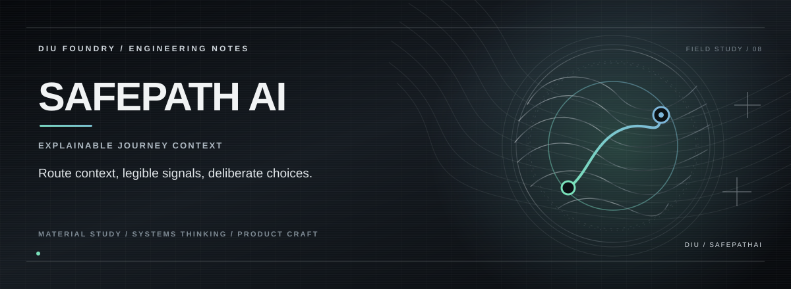

An AI-assisted journey-safety prototype exploring how route context, maps and explainable risk signals can work together. The current codebase is a React/TypeScript web app with Leaflet and Supabase integration.

> **Project status:** Prototype. Treat any risk indicators as experimental, not authoritative safety advice.

## What it explores

- Map and journey-context interfaces
- Safety signals designed to be understandable
- A product surface for future intelligent-service integrations
- Supabase as the application data/integration boundary

See the source code for the exact functionality currently implemented; integrations described as future work are not assumed to be live.

## Run locally

**Requirements:** Node.js 20 or newer and npm.

```bash
npm ci
cp .env.example .env
npm run dev
```

Vite will print the local development URL in the terminal.

## Environment

Set these in your local `.env` file:

| Variable | Purpose |
| --- | --- |
| `VITE_SUPABASE_URL` | Your Supabase project URL |
| `VITE_SUPABASE_ANON_KEY` | Your Supabase publishable/anon client key |

Vite variables are included in browser code. Use only the intended public anon/publishable key here; **never** put a Supabase service-role key or private provider secret in a `VITE_*` variable. Protect data with appropriate Supabase Row Level Security (RLS) policies.

## Quality checks

```bash
npm run build
npm run lint
npm run test
```

The test command runs Vitest. A green build or test run should be recorded only after running it against the current commit.

## Stack

React · TypeScript · Vite · Supabase · Leaflet · Recharts · Tailwind CSS · Vitest

## Project notes

This repository contains a prototype, not a guarantee of real-world safety outcomes. Test any integrations with non-sensitive data first.

---
Maintained by [K. Kishor Kumar](https://github.com/Kishordiu).
